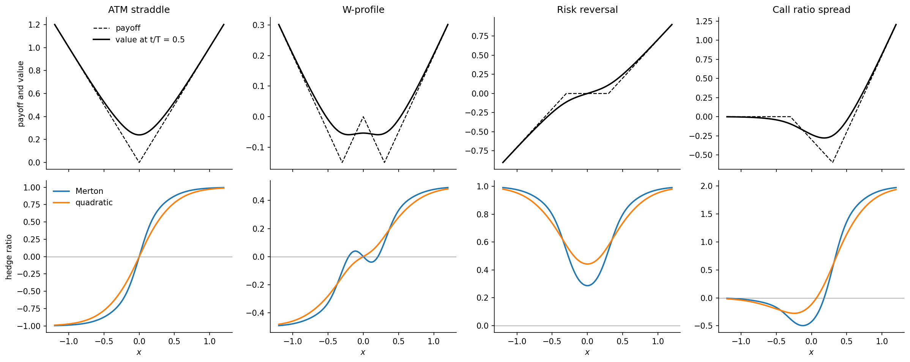
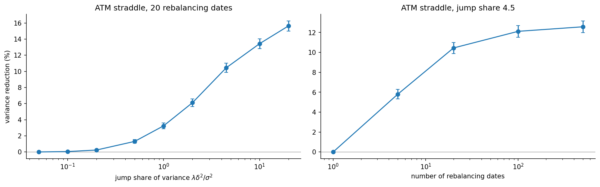
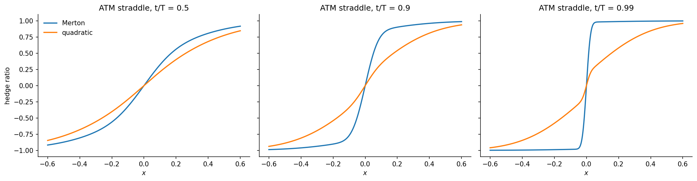

# Hedging short-dated options under jump-diffusion

When the underlying can jump, no hedge in the underlying replicates an option, and the textbook delta hedge is no longer the natural choice. This project compares two hedges for short-dated (0DTE/1DTE) options under a Bachelier jump-diffusion. Merton's hedge is the instantaneous delta $V_x$: it neutralizes small moves and ignores jumps. The quadratic hedge minimizes the variance of the hedging error and takes into account how a jump would change the option's value.

The project derives closed forms for both hedges for any portfolio of calls and puts, studies where and why they differ, and measures the difference by Monte Carlo across jump regimes, rebalancing frequencies, payoffs, transaction costs and parameter errors.

This work was done during my 2026 quantitative research internship at Bloomberg, in Bruno Dupire's team. The research questions were posed by the team; the derivations, code and results here are my own.



## Main results

Base case: short ATM straddle, $\sigma = 0.2$, $\lambda = 2$, $\delta = 0.3$, 20 rebalancing dates, 100,000 paths. Intervals are 95% confidence intervals.

| | Variance reduction of the quadratic hedge vs Merton |
|---|---|
| Base case | 10.4% ± 0.6% |
| Rebalancing 5 / 20 / 100 / 500 times | 5.8% / 10.4% / 12.1% / 12.6% |
| Jump share of variance 1 / 4.5 / 20 | 3.2% / 10.4% / 15.6% |
| W-profile / risk reversal / call ratio spread | 34.0% / 34.4% / 23.5% |
| Proportional cost c = 0.03 / 0.1 | 7.0% / 4.2% |

In the base case, the quadratic hedge also trades 23% less, shrinks the 1% loss quantile by 18% and more than halves the excess kurtosis of the P&L. Its advantage grows with the jump share of the variance and with rebalancing frequency. It is not significantly worse than Merton's hedge in any of the 45 misspecification scenarios tested, and it is barely affected by errors in $\sigma$ and $\lambda$, which move Merton's hedge considerably.



Close to expiry, Merton's hedge collapses to a step function at the strike, while the quadratic hedge keeps a smooth component set by the jump size. This is the regime of 0DTE options:



## Model

Under the pricing measure,

$$X_t = X_0 + \sigma W_t - \lambda m t + \sum_{i=1}^{N_t} Y_i, \qquad Y_i \sim \mathcal{N}(m, \delta^2),$$

an arithmetic model, which is appropriate over horizons of a day or less. Conditional on the number of jumps, $X_T$ is Gaussian, so prices are Poisson mixtures of Bachelier prices. Stein's lemma turns the jump integral in the quadratic hedge

$$\phi^*(t,x) = \frac{\sigma^2 V_x + \lambda\, \mathbb{E}\big[(V(t,x+Y) - V(t,x))\,Y\big]}{\sigma^2 + \lambda\,\mathbb{E}[Y^2]}$$

into a finite sum over neighbouring mixture components. The full derivations, including the one-off hedge and mixed-Gaussian jumps, are in [`notebooks/01_theory.ipynb`](notebooks/01_theory.ipynb).

### Time units

Only $\lambda T$, $\sigma^2 T$ and $\lambda\delta^2 T$ matter, so all results use $T = 1$. With $\lambda = 2$, the base case is an option whose remaining life contains on average two jump events, such as an expiry on a day with scheduled announcements. It is not a one-year option. For an ordinary trading day with a small chance of a jump, $\lambda T$ is small and the two hedges nearly coincide, which is itself one of the results (see the jump-share plot).

## Repository

```
jdhedge/                  pricing, path simulation and hedging (vectorized NumPy)
  model.py                model parameters and the four option portfolios
  pricing.py              values, Merton's hedge and the quadratic hedge in closed form
  paths.py                exact simulation on a time grid
  hedging.py              discrete hedging P&L and variance reduction with standard errors
scripts/run_simulations.py  all Monte Carlo scenarios (about 20 minutes on one core)
notebooks/
  01_theory.ipynb           derivations and numerical checks of every formula
  02_hedge_profiles.ipynb   where and why the two hedges differ
  03_simulation_results.ipynb  Monte Carlo results with confidence intervals
results/                  scenario table and base-case P&L samples
figures/                  figures used above
tests/                    unit tests
```

## Running it

```bash
pip install -r requirements.txt
pytest                              # about 1 minute
python scripts/run_simulations.py   # regenerates results/
jupyter notebook notebooks/
```

## References

- R. C. Merton (1976). Option pricing when underlying stock returns are discontinuous. *Journal of Financial Economics* 3, 125–144.
- H. Föllmer and D. Sondermann (1986). Hedging of non-redundant contingent claims. In *Contributions to Mathematical Economics*, North-Holland.
- R. Cont and P. Tankov (2004). *Financial Modelling with Jump Processes*. Chapman & Hall/CRC.
